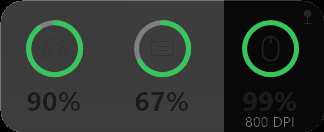

# T Hub

Windows 桌面小工具，实时显示**无线外设的电量**（鼠标还会显示当前 DPI）。不安装任何厂商驱动，直接通过 HID 与接收器通信。



## 特性

- **环形电量**：圆环填充表示电量，绿 / 黄 / 红三档配色，充电时显示闪电标记
- **信息分层**：每台设备依次显示 电量 → 型号 → 附加信息（鼠标为当前 DPI，充电时显示状态）
- **按信号显示**：只显示当前有响应的设备，休眠的设备自动消失，窗口宽度跟着设备数量收缩
- **毛玻璃背景**：抓取窗口背后的桌面做高斯模糊，再叠一层半透明白，圆角外完全透明
- **不置顶**：默认是普通窗口；点击右上角图钉固定位置并置顶，再点取消
- **开机自启**：右键菜单一键开关，写入当前用户 Run 键
- **单文件**：16 KB 的 exe，.NET Framework 4.8 系统自带，无运行时依赖

## 支持的设备

| 设备 | VID:PID | 电量 | 附加 |
|---|---|---|---|
| MCHOSE A5 V2 Ultra | `3837:100C` | ✅ | 800 DPI |
| MCHOSE A7 Pro | `5253:1021` | ✅ | DPI |
| MCHOSE V9 PRO 耳机 | `291D:385D` | ✅ | — |
| 狼途（LANGTU）T75 三模键盘 | `1A2C:8FFF` | ✅ | — |
| ATK 键盘 | `0x373B` 系列 | 🚧 待验证 | — |
| VGN 键盘（VHUB 协议 v2） | 按 productName 识别 | 🚧 已实现，待真机验证 | — |
| 罗技（HID++ 2.0） | `046D` 系列 | 🚧 待实现 | — |

## 安装

### 安装包（推荐）

从 [Releases](https://github.com/chuzihang123/T_hub/releases) 下载 `T-Hub-v1.0.0-setup.exe`：

- 安装到当前用户目录，不需要管理员权限
- 安装向导里可以勾选 **开机自动启动** 和 **创建桌面快捷方式**
- 卸载时会自动移除注册表里的自启项

### 免安装

下载 `T-Hub-v1.0.0-win64.zip`，解压后直接双击 `MchoseWidget.exe`。

| 操作 | 效果 |
|---|---|
| 拖动卡片 | 移动位置（固定状态下不可拖） |
| 点右上角图钉 | 固定：锁定位置 + 置顶，图钉变深并显示绿点 |
| 右键 | 置顶显示 / 锁定位置 / 开机自动启动 / 刷新 / 退出 |
| 双击托盘图标 | 显示或隐藏窗口 |

## 协议速查

三种设备走三套不同的 HID 通道，都是逐字节逆向出来的。

### MCHOSE 鼠标 — feature report

配置位于 vendor collection（usage page `0xFF01`）：

| 报告 | 长度 | 命令 |
|---|---|---|
| `0x11` | 21 | `0x03` 设备信息、`0x06` 电量 |
| `0x12` | 65 | `0x67` 完整配置（DPI 档位等） |

帧格式：`[report id][cmd ^ 0xFF][payload ^ 0xFF]`，无校验和，命令字节回显用于匹配。

`0x11 0x06` 解反后：`vid:u16, pid:u16, fw:u32, status:u8, battery:u8, charge:u8`。

### MCHOSE 耳机 — output / input report

| 方向 | 报告 | 内容 |
|---|---|---|
| 发 | `0x55` | `65 01 00 ...` |
| 收 | `0x55` | `65 <电量> <状态>`（状态 02 放电 / 03 充电 / 04 充满） |

### VGN 键盘 — output / input report

vendor collection 为 usage page `0xFF1C`，64 字节收发：

| 方向 | 报告 | 内容 |
|---|---|---|
| 发 | `0x04` | `00 00 1A 00 ...` |
| 收 | `0x04` | `00 00 1A <len> 00 00 00 <电量>` |

电量在回复的第 8 字节（含报告 ID 计数），实测与 VGN HUB 显示一致。

### 狼途 T75 键盘 — output / input report

| 方向 | 报告 | 内容 |
|---|---|---|
| 发 | `0x00` | `AA 55 CC 33 0E` + 59 字节 0 |
| 收 | `0x00` | `AA 55 CC 33 0E <电量>` |

第 4 字节是命令 `0x0E`，第 5 字节是电量。键盘也会主动广播同样的状态帧。

### VGN 键盘 — output / input report

VGN 的 VHUB 自带可读的 TypeScript SDK（`@sparklinkplayjoy/protocol-keyboard`），
帧格式直接照抄，不用再逐字节猜：

| 方向 | 内容 |
|---|---|
| 发 | 64 字节 `0D 01 00 …`（三模基本信息，`ThreeMode`=0x0D + `GetBasicInfo`=0x01） |
| 收 | `0D <status> <mode> <charge> <battery>`，`status` 0 为成功 |

`mode`：0 USB / 1 2.4G / 2–4 蓝牙；`charge`：0 未充电 / 1 充电中；
`battery` 就是电量百分比。设备通过厂商集合（usage page `0xFFA0` / `0xFFB0`，
usage 1）通信，**官方按 `productName` 字符串认型号，不按 PID**，所以同一套代码
能覆盖 S99 / V98Pro / N75 / VXE75 等一大票型号。

v1 老协议是另一套（帧头 `0x5C` + len + cmd + 累加校验），目前只做握手识别。

## 构建

需要 .NET Framework 4.8 自带的 C# 编译器（无需 SDK）：

```powershell
C:\Windows\Microsoft.NET\Framework64\v4.0.30319\csc.exe /nologo /target:winexe /platform:x64 /optimize+ ^
  /out:build\MchoseWidget.exe ^
  /reference:System.dll /reference:System.Drawing.dll /reference:System.Windows.Forms.dll ^
  src\MchoseWidget.cs
```

## 项目结构

```
src/MchoseWidget.cs     主程序：HID 协议、分层窗口、环形 UI、托盘、配置
poc/                    协议探测脚本（Python，逐个设备验证用）
tools/                  逆向辅助：WebHID 钩子、CDP 截图、启动脚本
docs/                   截图
build/                  编译产物
```

## 逆向方法

不同设备用了不同手段，记录在案：

1. **MCHOSE**：官方驱动是 Electron，解 `app.asar` 得到 WebHID 协议表
2. **耳机**：官方 HUB 以管理员运行，用 Chrome DevTools Protocol 挂到它的渲染进程，hook `HIDDevice` 的原型方法，抓到真实收发字节
3. **狼途 T75**：没有网页驱动，Inno 安装包静默解包后反汇编 `DeviceDriver.exe`，定位 `WriteFile` 调用点，读出 `AA 55 CC 33` 帧和电量偏移
4. **ATK / VGN**：NSIS 安装包 → `app-64.7z` → `app.asar`，已提取设备表和命令枚举，等待真机验证

## 已知限制

- 毛玻璃是「抓背景 + 模糊」的实现，背景内容变化后不会逐帧刷新（拖动结束或定时刷新）
- 抓背景时窗口会隐藏约 12 ms
- 设备进入休眠后会从界面消失，这是预期行为
- 仅支持 Windows（依赖 Win32 HID 与分层窗口）
